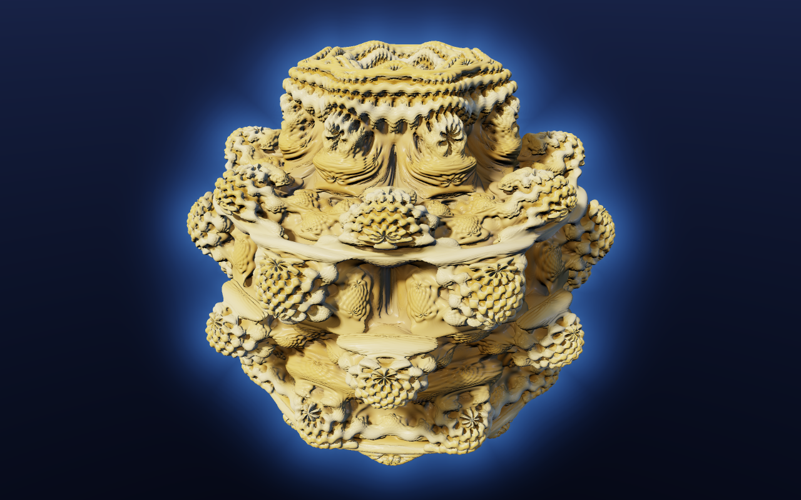
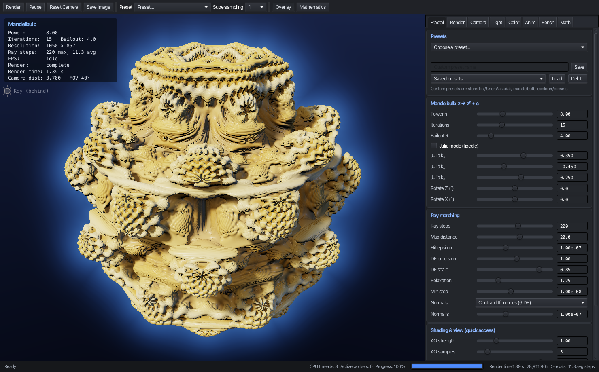
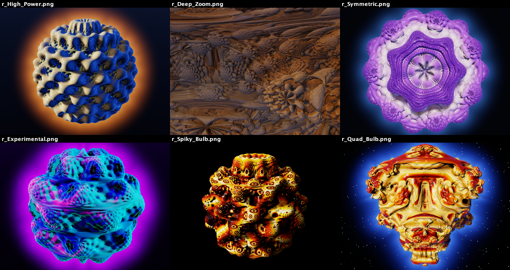

# Mandelbulb Explorer

An interactive, multithreaded **CPU ray-marching renderer** for the Mandelbulb fractal, written in
Java 21 with a JavaFX desktop UI.

Every pixel is computed from the Mandelbulb's escape-time iteration: a derivative-based distance
estimator drives sphere tracing; normals come from the gradient of that distance field; and
lighting, soft shadows, ambient occlusion and colouring are all derived from the same
mathematics. There are no meshes, voxels, point clouds or pre-rendered images anywhere.







*All images above were produced by the application itself (`docs/images`), using the headless
CLI and the UI snapshot hook described below.*

---

## Contents

1. [Quick start](#quick-start)
2. [Controls](#controls)
3. [The mathematics](#the-mathematics)
4. [Rendering pipeline](#rendering-pipeline)
5. [Architecture](#architecture)
6. [Parameters](#parameters)
7. [Performance](#performance)
8. [Presets, animation, export, benchmark](#presets-animation-export-benchmark)
9. [Testing](#testing)
10. [Design decisions and limitations](#design-decisions-and-limitations)
11. [Future GPU acceleration](#future-gpu-acceleration)

---

## Quick start

**Requirements:** JDK 21 (LTS) or newer. Maven is *not* required, because the Maven Wrapper
downloads it. JavaFX 21 is pulled from Maven Central with the correct native classifier for your
OS/CPU.

```bash
./mvnw javafx:run          # build and start the explorer
./mvnw test                # run the unit tests (92 tests)
./mvnw package             # build target/mandelbulb-explorer-1.0.0.jar
./mvnw javafx:jlink        # optional: self-contained runtime image in target/mandelbulb-explorer
```

On Windows use `mvnw.cmd` instead of `./mvnw`.

### Headless / command-line rendering

The renderer does not depend on JavaFX, so it can render from the command line:

```bash
./mvnw -q compile
java -cp target/classes com.mandelbulb.Main --render bulb.png --width 3840 --height 2160 --ss 2
java -cp target/classes com.mandelbulb.Main --render zoom.jpg --preset "Deep Zoom"
java -cp target/classes com.mandelbulb.Main --render x.png --power 9.5 --palette PLASMA \
     --lighting NEON --set color.mode=ORBIT_TRAP --set render.detail=2
java -cp target/classes com.mandelbulb.Main --benchmark
java -cp target/classes com.mandelbulb.Main --help
```

`--set key=value` accepts any scene setting with the same keys used by saved presets (for example
`fractal.bailout`, `render.aoSamples`, `lighting.key.azimuth` or `color.trapType`).

---

## Controls

| Input | Action |
|---|---|
| Left drag | Orbit around the pivot |
| Right drag | Pan |
| Middle drag | Fly (vertical = dolly, horizontal = strafe) |
| Scroll | Zoom toward the pivot; slows automatically near the surface |
| Alt / Ctrl + left drag | Free look (rotate around the eye) |
| Ctrl + right drag | Roll |
| Shift + left drag | Move the key light (azimuth / elevation) |
| Ctrl + scroll / Shift + scroll | Field of view / dolly |
| Double-click | Make the clicked surface point the orbit pivot |
| W A S D, R / F | Fly forward / left / back / right, up / down |
| Q / E | Roll |
| Arrow keys | Orbit |
| + / − | Zoom |
| Shift (held) | 4× faster keyboard movement |
| 1–9 / Ctrl+1–9 | Restore / save camera view (persisted in `~/.mandelbulb-explorer/cameras.properties`) |
| Home | Reset camera |
| O | Toggle information overlay |
| P | Pause / resume rendering |
| F5 | Render now |
| F11 | Full screen |
| Ctrl/Cmd + S | Export image |

Keyboard shortcuts act on the 3D view, so click it first. All camera motion is smoothed
(exponential approach to a goal camera, configurable in the **Camera** tab).

---

## The mathematics

### Spherical power map

The Mandelbulb (White & Nylander, 2009) extends the Mandelbrot iteration *z → z² + c* to 3D. There
is no 3D number system with a well-behaved multiplication, so "raising a point to a power" is
defined geometrically in spherical coordinates. It does to the angles what complex exponentiation
does in 2D: the angles are multiplied by *n* and the length is raised to the *n*-th power.

```
r = √(x² + y² + z²)
θ = acos(z / r)          polar angle from +Z, in [0, π]
φ = atan2(y, x)          azimuth, in (−π, π]

x' = rⁿ · sin(nθ) · cos(nφ)
y' = rⁿ · sin(nθ) · sin(nφ)
z' = rⁿ · cos(nθ)
```

### Iteration

```
z[0]   = c                         (Julia mode: z[0] = p, c = k constant)
z[k+1] = f(z[k]) + c
```

A point *c* belongs to the Mandelbulb if the orbit stays bounded. In practice we iterate until
|z| exceeds the bailout radius *R* or the iteration limit is reached. The default power is 8, and
fractional powers are supported.

**Why the bounding sphere is safe.** If |c| > 2^(1/(n−1)), then |z₁| = |cⁿ + c| ≥ |c|ⁿ − |c| > |c|,
and the orbit grows monotonically, so the set is contained in that ball. For n = 8 the ball
radius is 1.104. The renderer clips rays to a sphere with a generous margin around it.

### Distance estimation

Ray marching needs a *lower bound* on the distance from a point *p* to the surface. For
escape-time fractals it comes from the Hubbard–Douady potential *G(c) = lim log|z[k]| / nᵏ*.
Near the set, *G ≈ 0* and |∇G| is large. The distance to the set is approximately *G / |∇G|*,
which gives the classic estimator:

```
dr[0]   = 1
dr[k+1] = n · r[k]^(n−1) · dr[k] + 1          (Julia mode: without the "+ 1")
DE(p)   = ½ · log(r) · r / dr
```

*dr* is the running magnitude of the derivative ∂z/∂c (chain rule through the power map: locally
it scales lengths by *n rⁿ⁻¹*; the "+1" is the derivative of "+ c").

The power map is not conformal in 3D, so this is an *estimate*, not an exact Euclidean distance.
Steps are therefore multiplied by a **DE scale** ≤ 1. The unit tests measure how conservative the
estimate is. At 15 iterations no set point was found inside 0.85·DE balls. At 20 iterations
about 0.5% of samples are, independent of the ball radius: these are interior points whose
bounded orbit keeps |z| > 1, where ½·log r·r/dr is positive. Rays stop at the surface before
they ever reach such points, so this is harmless for rendering.

**Integer powers without trigonometry.** cos θ = z/r, sin θ = ρ/r, cos φ = x/ρ, sin φ = y/ρ
(with ρ = √(x²+y²)). By de Moivre, (cos a + i sin a)ⁿ = cos(na) + i sin(na). Raising these two
unit complex numbers to the *n*-th power by repeated squaring gives sin(nθ), cos(nθ), sin(nφ)
and cos(nφ) with no `acos`, `atan2`, `sin`, `cos` or `pow`. The result is algebraically identical
to the trigonometric form (a unit test checks agreement to 1e-9 for n = 2…20) and it is
**3.1× faster**. Fractional powers use the trigonometric formula.

**Numerical safeguards.** |z| < 1e-150 is treated as the origin (zⁿ = 0), since the angles are
undefined there. ρ = 0 (the polar axis) uses φ = 0. *dr* > 1e200 stops the iteration before it
overflows. A non-finite estimate is treated as "on the surface" (0). All user parameters are
clamped, and NaN/∞ inputs are replaced by defaults.

---

## Rendering pipeline

For every pixel (or each of s×s stratified sub-samples):

1. **Camera ray.** A pinhole camera builds the direction from the pixel position, field of view
   and aspect ratio. The eye and camera basis are pre-rotated into the fractal's object space
   once per frame, so object rotation costs nothing per step.
2. **Bounding sphere.** The ray is intersected with the sphere around the set. Rays that miss it
   are not marched at all.
3. **Sphere tracing.** Advance by `DE(p) · scale`. The ball of radius DE around *p* contains no
   surface, so the step is safe. Steps are long in empty space and shrink automatically near the
   surface.
   * **Hit threshold** ε(t) = max(hitEpsilon, t · pixelAngle / detail). This resolves the surface
     to about one pixel at every distance, which is essential for deep zooms.
   * **Adaptive over-relaxation** (Keinert et al. 2014): steps are multiplied by ω > 1. If the
     safe spheres of two consecutive points do not overlap (r_prev + r < step), the relaxed step
     may have skipped geometry. The marcher then returns to the last safe point and continues
     with plain steps. This also applies when a relaxed step overshoots the far end of the ray.
   * **Bisection** refines the hit if a step lands inside (DE < 0).
   * Rays that run out of steps while still very close to the surface count as hits, which
     avoids speckled holes in deep crevices.
4. **Normal.** The normal is the gradient of the DE by central differences (6 evaluations,
   second-order accurate) or a tetrahedral stencil (4 evaluations, first-order). The offset
   follows the pixel footprint. The same samples also give the DE Laplacian, a mean-curvature
   estimate used by the curvature colour mode.
5. **Colour.** The iteration is re-evaluated at the hit point with orbit statistics (smooth
   iteration count and orbit traps), and the chosen colour mode is mapped through the palette.
6. **Ambient occlusion.** The DE is sampled at *p + n·hᵢ*. On an open surface DE = h, so the
   deficit *(h − DE)* measures blocked hemisphere. Samples are weighted by 0.7ⁱ. The radius is
   proportional to the hit distance, so AO looks the same at every zoom level.
7. **Shadows.** A secondary ray is marched from the offset surface point toward each
   shadow-casting light, clipped to the bounding sphere (or to the point-light distance). Soft
   shadows use min(k · DE(t)/t): the angle by which the ray clears an occluder approximates
   partial visibility of an area light.
8. **Lighting** is computed in linear RGB. It combines Lambert diffuse, a Cook–Torrance/GGX
   specular term with Schlick Fresnel and Smith geometry (controlled by roughness), a
   hemispherical sky/ground ambient term times AO, Fresnel-weighted environment reflection, rim
   light, and exponential fog.
9. **Background.** Rays that miss get a sky gradient, a glow around the key light and optional
   stars. Rays that passed close to the surface get a silhouette glow; it is faded out before the
   bounding sphere so that it never shows a hard edge.
10. **Tone mapping.** Exposure, then an ACES filmic curve, then sRGB encoding through a lookup
    table. Supersamples are averaged after tone mapping.

### Progressive, multithreaded execution

* **Passes.** The first pass uses pixel blocks of 16/8/4/2 (whichever gives about 12k samples),
  then the block size halves, then comes the full-resolution pass with supersampling. Preview
  passes use a proportionally larger ε, so they are cheaper still. Every pass overwrites the
  image in place, tile by tile, starting from the centre.
* **Tiles and workers.** Each pass is split into 64×64 tiles. N workers (a fixed
  `ExecutorService`, automatic = number of cores, or a manual count) pull tiles from a shared
  `AtomicInteger`. This is lock-free load balancing: expensive tiles on the fractal don't stall
  the others.
* **Cancellation.** Every request increments a generation counter and cancels the running job.
  Workers check the flag every pixel row, so a stale job stops within milliseconds.
* **No stale frames.** Every job renders into its **own** frame buffer. A buffer is published
  for display only if its generation is still the newest (checked under the engine lock). A
  stale job therefore cannot overwrite a newer frame. Until the new job's first preview is ready,
  the previous image stays on screen, so there is no flicker. The unit tests fire 25 rapid
  requests and assert that only the last one is ever displayed.
* **Determinism.** A unit test checks that an 8-thread render is pixel-identical to a
  single-thread render.

---

## Architecture

```
src/main/java/com/mandelbulb/
├── Main.java                  entry point (GUI, or headless CLI with --render/--benchmark)
├── app/                       application model (no JavaFX types except the Application class)
│   ├── MandelbulbApplication  JavaFX Application
│   ├── ApplicationState       live scene, camera, engine, animation; coalesces render requests
│   ├── PresetStore            custom presets + camera bookmarks (~/.mandelbulb-explorer)
│   └── HeadlessRunner         command-line rendering / benchmarking
├── math/                      Vector3, Vector2, Quaternion, Matrix4, Color3, MathUtils
├── fractal/                   the mathematics only
│   ├── DistanceEstimator      interface (primitive-double API)
│   ├── Mandelbulb             iteration + distance estimator (+ reference trig implementation)
│   ├── OrbitTrap / TrapType   orbit statistics
│   └── FractalParameters
├── camera/                    Camera (immutable orbit rig), CameraController (input, smoothing)
├── scene/                     Scene snapshot: Light, LightingSettings, ColorSettings,
│                              LightingPreset, FractalPreset
├── rendering/                 CPU renderer
│   ├── Renderer               per-pixel kernel (camera ray → … → tone mapping)
│   ├── RayMarcher, SurfaceNormal, AmbientOcclusion, ShadowRenderer, Lighting, ColorMapper
│   ├── Ray, HitResult, RenderContext   per-thread mutable scratch (zero allocation)
│   ├── RenderEngine           progressive tiles, workers, cancellation, publication
│   ├── RenderBackend          extension point (export/benchmark/animation depend only on this)
│   └── RenderSettings, Palette, ColorMode, …
├── animation/                 AnimationController, AnimationSettings, CameraPath, Easing
├── export/                    ImageExporter (PNG / JPEG via ImageIO)
├── benchmark/                 Benchmark (configurations, statistics, CPU utilisation)
├── ui/                        JavaFX views: MainWindow, ViewportPane, ControlPanel and tabs
│                              (ParameterPanel, RenderPanel, CameraPanel, LightingPanel,
│                              ColoringPanel, AnimationPanel, BenchmarkPanel, MathematicsPanel),
│                              ParameterSlider, BoundControls, Dialogs, ExportDialog, StatusBar
└── util/                      Settings (reflective deep copy), SettingsCodec (properties I/O)
```

**Data flow.** UI controls edit a *live* `Scene` on the FX thread through getter/setter lambdas
(`BoundControls`). Once per screen refresh, `ApplicationState.pulse()` advances camera smoothing
and animation, and, if anything changed, deep-copies the scene into a snapshot. It submits one
coalesced `RenderRequest`. Render threads only ever see that immutable-by-convention snapshot, so
the pixel loop needs no locks. The viewport polls the engine's latest publishable frame and blits
it into a `WritableImage` only when its version changed.

**Dependencies.** `math`, `fractal`, `camera`, `scene`, `rendering`, `animation`, `export` and
`benchmark` do not depend on JavaFX. The whole renderer runs headless, which the CLI and the
tests rely on.

---

## Parameters

| Parameter | Range | Meaning |
|---|---|---|
| Power n | 2 – 20 | Exponent of the spherical power map; fractional values allowed |
| Iterations | 2 – 1000 | Iteration limit. 10–20 suffice at normal zoom; deep zooms need more |
| Bailout R | 2 – 100 | Escape radius |
| Julia mode, k | ±1.5 | Iterate z → zⁿ + k with a fixed k |
| Rotate Z / X | ±180° | Object rotation (applied to rays, free in the march loop) |
| Ray steps | 16 – 2000 | Max sphere-tracing steps per primary ray |
| Max distance | 1 – 200 | Ray length limit (also limited by the camera's far clip) |
| Hit epsilon | 1e-10 – 1e-2 | Absolute minimum hit threshold |
| DE precision (detail) | 0.1 – 8 | Hit threshold = pixel footprint / detail |
| DE scale | 0.1 – 1 | Step = DE × scale (lower for high powers and Julia sets) |
| Relaxation | 1 – 1.9 | Over-relaxation factor ω (1 = plain sphere tracing) |
| Min step | 1e-12 – 1e-3 | Guarantees progress where the DE underflows |
| Normals, normal ε | — | Central / tetrahedral gradient; minimum offset |
| AO strength / radius / samples | 0–4 / 0.001–0.5 / 1–32 | Ambient occlusion |
| Shadow strength / softness / steps | 0–1 / 0–1 / 4–1000 | Shadow rays |
| Light intensity, colour, azimuth, elevation | — | Key and fill (directional) and point light |
| Specular, roughness, Fresnel, reflectivity, rim | — | Material |
| Exposure, fog, sky colours, stars, glow | — | Environment |
| Palette, colour mode, offset, frequency | — | Colouring |
| Orbit trap on/off, type, blend, scale | — | Orbit-trap colouring |
| FOV, near, far, smoothing | 5–140°, … | Camera |
| Resolution mode, fixed size, viewport scale | 640×480 … 3840×2160 | Render resolution |
| Supersampling | 1×, 2×, 3×, 4× | s×s stratified samples per pixel in the final pass |
| Threads | auto / 1 – 64+ | Worker count |

**Colour modes:** combined (iteration + trap), orbit trap, orbit-trap RGB (min |x|, |y|, |z| →
R, G, B), smooth iteration count, height, radial distance, curvature (DE Laplacian), surface
normal, world position, ray-march step count, and solid.
**Palettes:** Fire, Ice, Plasma, Ocean, Emerald, Purple, Gold, Monochrome, Rainbow, Electric
Blue, Lava, Sunset, Copper, Bone.
**Orbit traps:** planes x/y/z = 0, origin, point (0.5, 0.5, 0.5), sphere shell r = 1, coordinate
axes, nearest plane.
**Lighting presets:** Studio, Cinematic, Soft, High Contrast, Space, Neon, Sunset.

Invalid input can never reach the renderer. Text fields reject unparsable values (red highlight,
then revert) and clamp to the range. Every settings class has a `validate()` that clamps values
and replaces NaN/∞. Rendering runs off the UI thread and is cancellable, so an expensive setting
cannot freeze the window. Very large exports ask for confirmation, and out-of-memory conditions
produce a readable error.

---

## Performance

Measured on an 8-core Apple Silicon machine (`--benchmark`, default scene, after JIT warm-up):

| Configuration | Time | DE evaluations | Throughput | CPU |
|---|---|---|---|---|
| 640×480, no AO/shadows | 0.08 s | 3.5 M | 3.6 M rays/s | 98% |
| 640×480, defaults | 0.11 s | 6.3 M | 2.9 M rays/s | 98% |
| 640×480, 2×2 SS, detail 2 | 0.52 s | 30.5 M | 2.4 M rays/s | 97% |
| 1920×1080, defaults | 0.65 s | 37.5 M | 3.2 M rays/s | 97% |

What makes it fast:

* **Zero allocation in the hot path.** Rays, hit results, orbit traps, normals and colours live
  in a per-thread `RenderContext`, and multi-value results are written into its fields. The DE,
  marcher, shading and colour mapper take primitive `double`s. `Vector3` (immutable) is only used
  per frame, never per step.
* **Trig-free integer powers** (3.1× faster than the trigonometric form, identical geometry).
* **Per-frame precomputation.** Camera basis and lights are transformed into object space, and
  palettes and sRGB encoding use lookup tables.
* **Bounding-sphere clipping, pixel-footprint ε, over-relaxation and early termination.**
* **Cheap progressive previews** (few samples with a larger ε) and centre-out tile order.
* **Work-stealing tiles** with no locks and one counter increment per tile; worker threads run
  slightly below normal priority so the UI stays responsive.

Tips: lower *viewport scale* for faster interaction on big or HiDPI screens. *Relaxation*
1.2–1.4 is usually the fastest safe setting. High powers and Julia sets need a lower *DE scale*
(about 0.6–0.7) to avoid overshooting artefacts.

---

## Presets, animation, export, benchmark

* **Fractal presets** (toolbar, *Presets* menu, *Fractal* tab): Classic Mandelbulb, High Power,
  Low Power, Smooth Bulb, Spiky Bulb, Deep Zoom, Dense Detail, Symmetric, Experimental (Julia,
  n = 7.5) and Quad Bulb. A preset sets the fractal, quality, colouring, lighting and camera but
  keeps your resolution, supersampling and thread settings. **Custom presets** save the complete
  scene, camera included, as readable `.properties` files in `~/.mandelbulb-explorer/presets/`.
* **Animation** (*Anim* tab): rotate the bulb, orbit the camera, oscillate the power, circle the
  key light and shift the palette. Transport has Play, Pause and Stop, plus a playback quality
  setting (full, ½, ¼ or ⅛ resolution; playback renders as fast as the CPU allows).
* **Fly-through:** add camera waypoints from the current view, reorder them, and fly along
  them. Positions follow a Catmull-Rom spline and orientations a quaternion Catmull-Rom spline,
  with selectable easing (linear, smoothstep, sine, cubic, quadratic in/out) and optional
  looping.
* **Record** renders a numbered PNG sequence off-line at any resolution and supersampling, with
  exact 1/fps time steps, so the output is deterministic. Encode it with
  `ffmpeg -framerate 30 -i frame_%05d.png -pix_fmt yuv420p mandelbulb.mp4`.
* **Export image** (Ctrl/Cmd+S, *Save Image*): re-renders the current view off-screen at
  640×480 … 3840×2160, at the current render size, or at a custom size (up to 16384²), with 1–4×
  supersampling, as PNG or JPEG. The default name is `mandelbulb_<W>x<H>.png`. Only the fractal
  is exported, never the UI.
* **Benchmark** (*Bench* tab or `--benchmark`): render time, pixels, primary and shadow rays, DE
  evaluations (total and per second), average and maximum march steps, rays per second, and
  process CPU utilisation. Results accumulate in a table so you can compare configurations, and
  a standard suite runs fast, balanced, quality and Full HD settings.
* **Mathematics** tab: the equations with live parameter values, plus a worked example at any
  point (or the surface point at the screen centre). It shows r, θ, φ, rⁿ, nθ, nφ, the
  transformed coordinates, the first orbit iterates, the escape and smooth iteration counts, the
  DE value and the orbit-trap minima.

---

## Testing

```bash
./mvnw test
```

The 92 JUnit 5 tests cover:

* **Vector/quaternion/matrix maths:** products, normalisation of degenerate vectors, spherical
  round trips, slerp, and basis conversion.
* **Mandelbulb:** the spherical power definition; the integer fast path against the trigonometric
  reference for n = 2…20; fractional powers; the origin, far points, tiny radii (down to
  `Double.MIN_VALUE`), the polar axis and 1000 iterations; the escape bound; DE monotonicity and
  conservativeness; orbit traps; and Julia mode.
* **Ray marching:** analytic sphere hits for several relaxation factors, misses, far clipping,
  starting inside the surface, over-relaxation not skipping thin geometry, and Mandelbulb hits
  with no skipped surface along the ray.
* **Normals:** analytic sphere normals and Laplacian for both stencils, unit length on the bulb,
  and the degenerate-gradient fallback.
* **AO and shadows:** open versus occluded surfaces, hard shadows, point-light range and the
  penumbra.
* **Renderer and engine:** hit/miss layout, supersample counts, determinism, multithreaded
  equals single-threaded, cancellation, every preset rendering, the pass schedule, tile
  coverage, progressive completion, stale-frame suppression under 25 rapid requests, prompt
  worker shutdown on cancel, and thread-count changes.
* **Camera:** orthonormal basis, orbit/free-look invariants, projection, sanitising invalid
  states, and interpolation. Zooming and flying never enter the surface.
* **Settings:** properties round trip, malformed/NaN/out-of-range input, and deep-copy
  independence.
* **Animation:** paths pass through their waypoints and are continuous, easing endpoints, and
  animated scenes are pure functions of time.

**UI verification hook.** The window can snapshot itself to a PNG, which is useful for CI or
machines without screen-capture permission:

```bash
./mvnw -q compile
CP=$(./mvnw -q dependency:build-classpath -Dmdep.outputFile=/dev/stdout -Dmdep.includeScope=compile)
java --module-path "target/classes:$CP" -Dmandelbulb.snapshot=ui.png \
     -Dmandelbulb.snapshotDelay=6 -Dmandelbulb.snapshotTab=Math -Dmandelbulb.snapshotExit=true \
     -m com.mandelbulb/com.mandelbulb.Main
```

Further options are `-Dmandelbulb.snapshotPreset=<name>` and `-Dmandelbulb.snapshotPlay=true`.

---

## Design decisions and limitations

* **JavaFX + Maven**, with the Maven Wrapper for a reproducible build. The project is a JPMS
  module (`com.mandelbulb`). Tests run on the class path because the tested packages don't use
  JavaFX.
* **Z-up world.** The Mandelbulb's polar axis is Z, so the camera uses Z as up and no hidden axis
  swap is needed.
* **Camera as an orbit rig** (pivot + quaternion + distance). Smoothing interpolates the pivot
  and orientation, so the eye moves along arcs instead of chords that could cut through the
  fractal. Movement speed scales with the DE at the eye. Zooming approaches the surface by at
  most half the remaining distance, with a 1e-10 minimum standoff, so the camera can't enter the
  fractal by rounding.
* **Supersampling is per-pixel** (s×s stratified samples averaged after tone mapping) rather
  than rendering a larger image and downscaling. It gives the same result without an s²-times
  larger buffer, which is what makes 3840×2160 at 4× feasible in memory.
* **Reflections** are Fresnel-weighted environment reflections rather than traced secondary
  bounces. A traced reflection would roughly double the cost for little visual gain on a rough
  fractal surface.
* **The DE is an estimate** (see above). The DE scale and relaxation fallback keep marching
  robust. At extreme powers or in Julia mode, lower the DE scale if you see banding or holes.
* **Double precision** limits zoom depth to roughly 1e-12 relative scale.
* **Video.** Animations are exported as PNG sequences, because encoding video would need a
  native/third-party dependency.
* **macOS:** the menu bar is the system menu bar, and F5/F11 are handled by a key filter because
  macOS menus can't bind bare function keys.

---

## Future GPU acceleration

The renderer was designed so that a GPU backend can be added without touching the UI or the
scene model:

* `RenderBackend` is the only interface that export, benchmarking and animation recording use. A
  GPU implementation only has to render a `Scene` snapshot into ARGB pixels.
* `Renderer` is a pure function of (scene snapshot, pixel) built from primitive-double
  components: `Mandelbulb.distance`, `RayMarcher`, `SurfaceNormal`, `AmbientOcclusion`,
  `ShadowRenderer`, `Lighting` and `ColorMapper`. Each maps one-to-one onto a GLSL/HLSL/OpenCL
  function. The snapshot fields become uniforms, and the palette LUT becomes a 1D texture.
* Possible routes are LWJGL (OpenGL 4.3 compute or fragment shaders; Vulkan), JOCL/TornadoVM
  (OpenCL/PTX from Java), or JavaFX's own Prism pipeline via a `Canvas` fed from a GPU readback.
* GPU float precision (fp32) limits deep zooms. Hybrid designs keep the CPU double-precision path
  for zooms beyond ~1e-5 and use the GPU for interactive previews. The progressive engine
  (passes and publication) can remain on the CPU side and treat the GPU as a very fast tile
  renderer.
